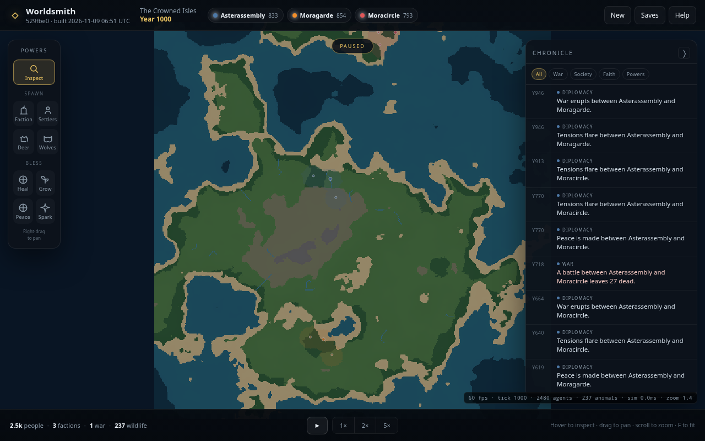
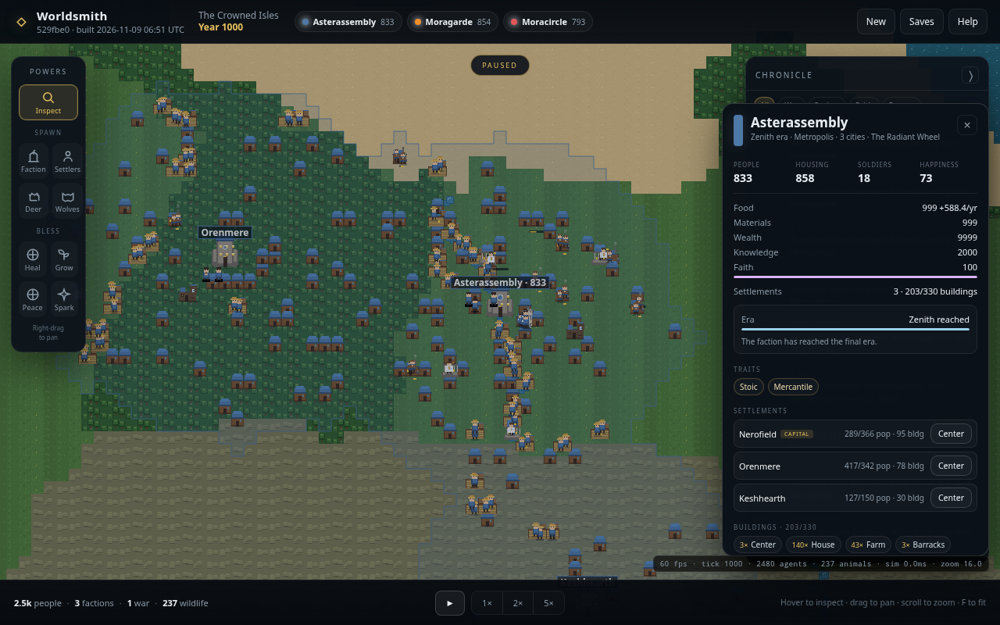

# Worldsmith

A browser-based god sandbox. Shape a world, seed its peoples, then watch factions grow
from six founders into towns — farming, worshipping, quarrelling, starving, signing
peace and going to war. You do not win. You intervene, or you don't, and the chronicle
remembers.

Built with **Vite + strict TypeScript + Canvas 2D**, no runtime dependencies, and no
external art assets — every tile, unit, building and icon is generated procedurally in
code.





## Project docs

- [PLAN.md](PLAN.md) — the living project plan: goals, milestones, status and roadmap.
- [AGENTS.md](AGENTS.md) — conventions and commands for coding agents working here.

## Run it

```bash
npm install
npm run dev
# open http://127.0.0.1:5173/ — or http://<container-ip>:5173/
```

The dev server binds `0.0.0.0`, so loopback and the container/network IP both work.
To restrict it to localhost again, set `server.host` to `'127.0.0.1'` in `vite.config.ts`
(or start it once with `npm run dev -- --host 127.0.0.1`).

Create a world from the opening screen: choose a seed, a size (256², 512² or 1024²),
and whether to begin with three factions plus wildlife or an empty wilderness.

## What is simulated

- **World generation** — fractal elevation, adaptive sea level, moisture and biomes,
  rivers carved downhill across the land. Same seed produces the same world.
- **Factions** — generated names, banner colours and two traits (militarist, fertile,
  industrious, zealous, scholarly, mercantile, stoic). Each starts with a town centre,
  houses, farms and six founders.
- **People, not numbers** — every villager is an agent with a home, job, age, health,
  hunger, happiness, faith and family. Couples marry, raise children, grow old and die.
  Children become workers; orphaned children stay with the faction.
- **Economy** — food, materials, wealth and knowledge. Farms depend on soil fertility,
  workshops make materials and wealth, temples make knowledge and faith, houses make
  room for growth. Famine is possible when harvests fall behind population.
- **Settlement growth** — camps grow into villages, towns and cities. Building caps and
  territory radius expand with population.
- **Eras** — factions climb from the Hearth through Craft and Engine to the Zenith era,
  unlocking new buildings and improving their soldiers.
- **Culture and religion** — traits bias births, production, war and faith; each faction
  has a patron belief that can spread to neighbours under the right conditions.
- **Diplomacy and war** — relations drift with incidents, religion and trade-mindedness.
  Armies recruit from the people, march to enemy buildings, skirmish, siege and raze.
  Wars end from exhaustion, duration, or divine intervention. A capital can fall.
- **Light wildlife** — deer wander and breed; wolves hunt deer. Populations are capped.
- **A chronicle** — settlements, eras, wars, battles, peace, famine, conversions and
  divine acts are recorded. Entries with a location can be clicked to jump there.

## Divine powers

| Group | Powers |
|---|---|
| Spawn | Faction · Settlers · Deer · Wolves |
| Bless | Heal · Fertility · Peace · Insight |

Powers are free and always unlocked. Each has a short cooldown; the brush slider sets
the area for area blessings. Faction spawning requires open land away from existing
capitals; settlers require a faction's territory. The world is a pure sandbox — no win
condition and no loss condition.

## Controls

| Input | Action |
|---|---|
| Space | Pause / resume |
| 1 / 2 / 3 | Speed 1× / 2× / 5× |
| Scroll | Zoom toward cursor |
| Right or middle drag | Pan the map |
| Left drag with no power | Pan the map |
| Left drag with a power | Brush the power over the land |
| Hover / click | Inspect land, buildings, animals or people |
| F | Fit the whole world |
| C | Toggle the chronicle |
| H | Help |
| [ / ] | Brush radius |
| Esc | Cancel power / close panels |

## Saves

Autosave runs every 30 seconds and when the tab is hidden. Three manual slots are
available under **Saves**. Saves are stored in IndexedDB on this browser, keyed by a
versioned schema; incompatible saves are refused with a message. Loading restores the
world, people, relationships, wars, RNG state and chronicle, then continues the
simulation deterministically.

Autosave can be resumed from the creation screen after a reload when IndexedDB is
available. If browser storage is unavailable, blocked, or fails to open, saves use
temporary memory. The Saves menu and save notifications warn that these saves are
lost when the page is reloaded or closed.

## Tech notes

```
src/
  config.ts            all tuning constants: caps, rates, buildings, eras, traits
  core/                seeded PRNG (mulberry32), value noise/fBm, helpers
  world/               world model, procedural generation, ownership/territory
  sim/                 Game orchestrator + agents, economy, war, diplomacy, progress,
                       environment, powers, pathfinding, save snapshots
  render/              procedural sprite atlas, camera, chunked Canvas 2D renderer
  ui/                  creation screen, HUD, chronicle, civ panel, saves, help
  persist/             IndexedDB storage wrapper
  main.ts              app wiring, input, fixed-step game loop, autosave
```

- **Time:** one tick equals one game year. 1× runs 2 ticks/second; 5× runs 10.
- **Rendering:** chunked 16 px tiles cached at 16 px/tile, with a 1 px/tile overview
  texture for zoomed-out views and a re-generated territory overlay. Day/night is a
  purely cosmetic tint on a 120-second cycle.
- **Scale:** the simulation is designed to keep running while zoomed out. Population
  caps are 1,200 / 2,500 / 4,000 agents for 256² / 512² / 1,024². Wildlife caps are
  150 / 300 / 500.
- **Save format:** versioned `GameSave` object; the codec is covered by a deterministic
  save → load → 120-tick continuation test.
- **Measured in this verification environment** (headless Chromium, software renderer,
  1280×800): ~60 fps at 256² and 1,024² while paused *and* while running at 5× with
  ~500–530 agents; simulation cost ~1–2 ms/tick at 1,024². Actual frame rate depends on
  hardware, but the renderer is layered for exactly this: the overview texture and
  territory overlay carry zoomed-out views, while chunk canvases only cover what is on
  screen.

## Scripts

```bash
npm run dev        # Vite dev server on http://127.0.0.1:5173 (all interfaces)
npm run build      # tsc --noEmit && vite build
npm run preview    # preview the production build
npm run deploy     # build, then deploy to Cloudflare Workers
npm test           # Vitest: generation, simulation, powers, pathfinding, saves
npm run typecheck  # strict TypeScript
```

## Deploy

The production build is a fully static site (`dist/`), so any static host works.
`wrangler.jsonc` configures Cloudflare Workers to serve `dist/` as static assets.

The game header displays the short Git commit hash and UTC build time, embedded by
Vite when building (or starting the dev server). Builds without Git metadata display
`unknown` for the commit. The timestamp records the build, not deployment.

**Cloudflare Workers (static assets)** — build command `npm run build`, deploy command
`npx wrangler deploy` (or run `npm run deploy` locally after `npx wrangler login`).

**Cloudflare Pages** — framework preset none, build command `npm run build`, build
output directory `dist`. No server code, functions or environment variables are needed.

## Current limits (deliberately deferred)

The MVP was scoped to the society simulation. Not included yet: terrain sculpting and
destructive disasters (fire, meteor, earthquake, flood), plague/drought/weather,
monsters, minimap, world file import/export and seed sharing, statistical graphs,
sound, mobile/touch controls, and screenshot export. All tuning lives in
`src/config.ts`, so balancing and new powers can be added without touching the renderer
or UI structure.

## License

No license has been chosen for this project yet.
